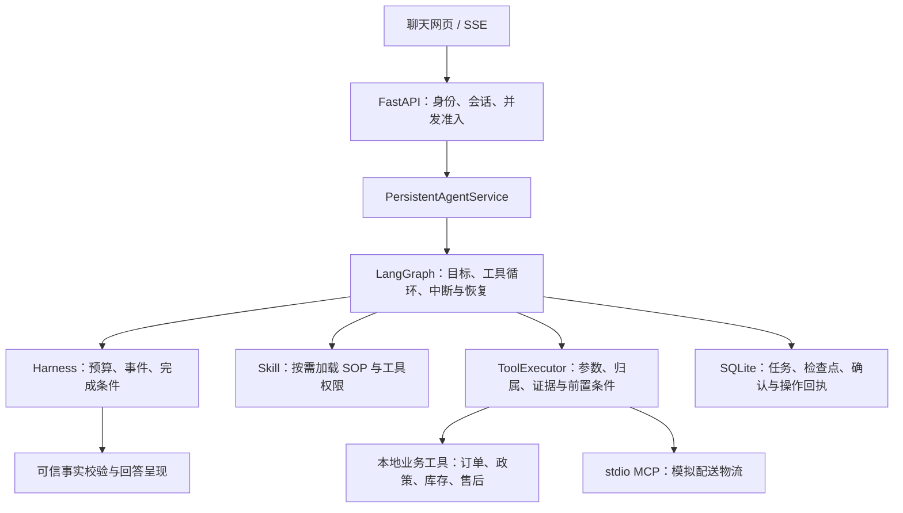

# SkillFlow Agent

基于 LangGraph 的数码小店售后 Agent，同时考虑针对突发新闻多用户同时涌入平台的多并发问题进行设计处理。模型按需加载 Skill、调用工具并读取结果，运行时负责权限、预算、证据校验、任务恢复和申请确认。

项目独立运行，订单、库存、政策、质量事件及物流使用本仓库的模拟数据；模型调用、LangGraph 检查点和 stdio MCP 协议实际执行。当前版本主要是一个demo级别，未接入真实数据，主要是体现对于自动进行判断tool调用、多并发情况的理解处理。

## 架构与阅读入口



| 模块 | 代码入口 |
|---|---|
| HTTP 接入、身份和服务装配 | [skillflow/api.py](skillflow/api.py)、[bootstrap.py](skillflow/agent/bootstrap.py) |
| Agent 编排与持久化执行 | [persistent_graph.py](skillflow/agent/persistent_graph.py)、[persistent_service.py](skillflow/agent/persistent_service.py) |
| 真实模型与原生工具调用 | [chat_model.py](skillflow/agent/adapters/chat_model.py) |
| Harness 与工具校验 | [harness.py](skillflow/agent/harness.py)、[tool_executor.py](skillflow/agent/tool_executor.py) |
| Skill 注册与规范 | [skills.py](skillflow/agent/skills.py)、[skillflow/skills](skillflow/skills) |
| MCP 接入 | [mcp_bootstrap.py](skillflow/agent/adapters/mcp_bootstrap.py)、[logistics_mcp](skillflow/integrations/logistics_mcp) |
| 会话目标与任务记忆 | [conversation_state.py](skillflow/agent/conversation_state.py)、[conversation.py](skillflow/agent/adapters/conversation.py) |
| 网页 | [index.html](skillflow/web/index.html) |

- **LangGraph** 负责有状态循环、分支、interrupt 与恢复；**LangChain** 提供模型、消息和工具适配。
- 当前流程采用 ReAct 风格的工具决策循环；模型选择 Skill 和工具，运行时执行检查。没有独立的长期反思 Agent。
- 记忆分为当前任务消息、默认 30 分钟的会话调查目的、图检查点及业务审计记录。换单时重新校验归属和事实；不继承申请授权。
- S3 / S4 / S5 / S6 是建设阶段及兼容配置：分别对应真实工具循环、持久化与确认、MCP、登录环境接入。完整部署使用同一个服务入口。

## Docker 快速启动

需要 Docker Engine / Docker Desktop 和可用的 OpenAI 兼容模型服务。仓库不包含 API Key、账号密码、证书或现有数据库。

1. 复制配置模板：

   ```powershell
   Copy-Item .env.example .env
   ```

   Linux / macOS 使用 `cp .env.example .env`。

2. 在本机 `.env` 中填写：

   ```dotenv
   SKILLFLOW_MODEL=your-tool-calling-model
   SKILLFLOW_BASE_URL=https://your-provider.example/v1
   SKILLFLOW_API_KEY=your-api-key
   ```

   模型必须支持原生 tool calling 与结构化输出。容器访问宿主机的模型服务时，应使用容器可访问的地址。

3. 构建并启动：

   ```sh
   docker compose -p skillflow-demo -f compose.demo.yaml up -d --build
   docker compose -p skillflow-demo -f compose.demo.yaml ps
   ```

   打开 <http://localhost:8001/>。如果本机已有服务占用 8001，请先自行选择空闲宿主机端口修改 `compose.demo.yaml` 的映射。该配置使用独立 Docker 数据卷，不加载本机既有业务库。

4. 在聊天中输入：

   - `只查 A123 的订单状态`
   - `核对 A123 的退换资格，并查询配送物流。`
   - `为 A123 申请退货`，核对确认卡片后再决定是否提交。

   演示身份为 `demo-buyer`。退换资格与库存分别核验；确认申请只创建模拟售后工单，不执行真实退款。快速启动包含订单、政策、库存和物流样本；质量事件专项样本可使用保留的阶段演示脚本在隔离库中准备。

停止演示并保留数据：

```sh
docker compose -p skillflow-demo -f compose.demo.yaml down
```

### 镜像与离线打包

```sh
docker build -t skillflow-agent:local .
docker save -o artifacts/skillflow-agent.tar skillflow-agent:local
# 另一台机器导入：
docker load -i artifacts/skillflow-agent.tar
```

导出前先创建 `artifacts` 目录。该目录不进入 Git 或 Docker 构建上下文。

推送到 GitHub 后，[Docker 工作流](.github/workflows/docker.yml)会构建镜像并发布到当前仓库所属账号的 GHCR；标签为 `latest` 和对应提交 SHA。私有镜像拉取需要登录具备权限的 GitHub 账号。

### 正式登录部署

[compose.local.yaml](compose.local.yaml)保留已有 HTTPS + Keycloak 接入方式。它要求单独准备本机 `.env`、证书、根 CA、OIDC 客户端和业务数据；不是全新机器的一键部署配置。

`SKILLFLOW_CERT_DIR`、`SKILLFLOW_CA_FILE` 由部署者设置。已有数据环境进行样本增量准备时，先备份并阅读 [prepare_agent_s6.py](scripts/prepare_agent_s6.py) 的预览输出，不能用演示身份代替真实登录。

## 本地开发与回归

建议 Python 3.12，与 Docker 镜像及 CI 保持一致：

```sh
python -m venv .venv
# Windows：.venv\Scripts\python.exe；Linux / macOS：.venv/bin/python
python -m pip install -r requirements.lock.txt
python -m pip install pytest ruff
python -m pytest tests/ tests_skillflow/ -q
ruff check corecoder tests
```

先激活新建的虚拟环境，再执行安装与测试命令。测试覆盖模拟模型、工具合同、权限、任务恢复、确认事务与 MCP 故障场景；自动回归通过不代表真实模型容量验收通过。旧阶段启动及验收脚本保留用于复现。

## 当前限制

- 业务和物流为固定模拟数据；需要另行接入真实订单源、物流源和退款系统。
- 并发准入和会话锁按单进程设计；当前 SQLite 部署不作为多副本方案。
- 真实模型容量评测完成 120 次任务，其中 115 次满足正确性要求，整体未通过全部门槛；目标扩张及部分响应延迟仍是已知问题。
- 保留旧阶段入口以维持兼容，本次发布没有重构业务执行流程。

## 来源与文件范围

项目派生自 [CoreCoder](https://github.com/he-yufeng/CoreCoder)，保留其 MIT License 与必要代码；来源说明见 [UPSTREAM.md](UPSTREAM.md)。当前聊天应用使用自己的 LangGraph 运行时，并复用上游 Tool 基类。

Git 和 Docker 均排除个人文档、`docs/`、学习文章、历史验收报告、截图、`.env`、证书、数据库、缓存及镜像导出文件。仓库保留的 Markdown 主要是 README、来源说明、业务政策及运行必需的 Skill SOP。
